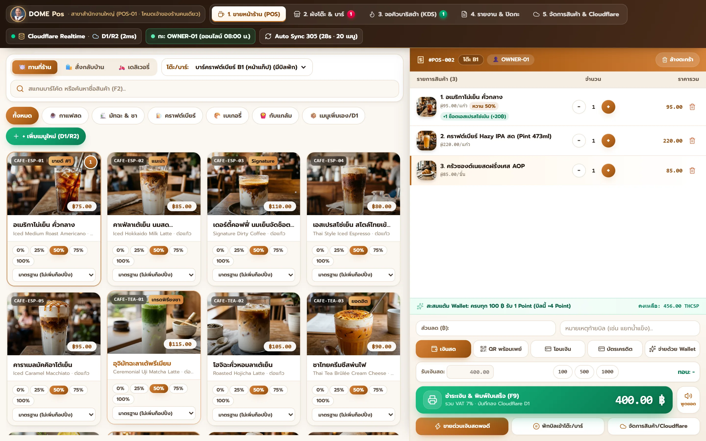
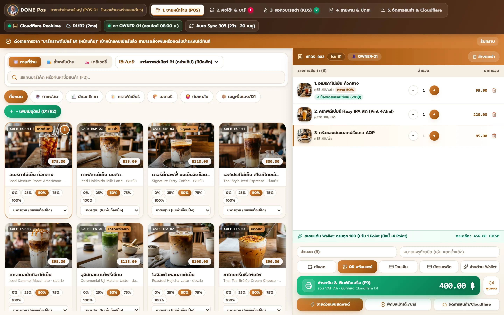
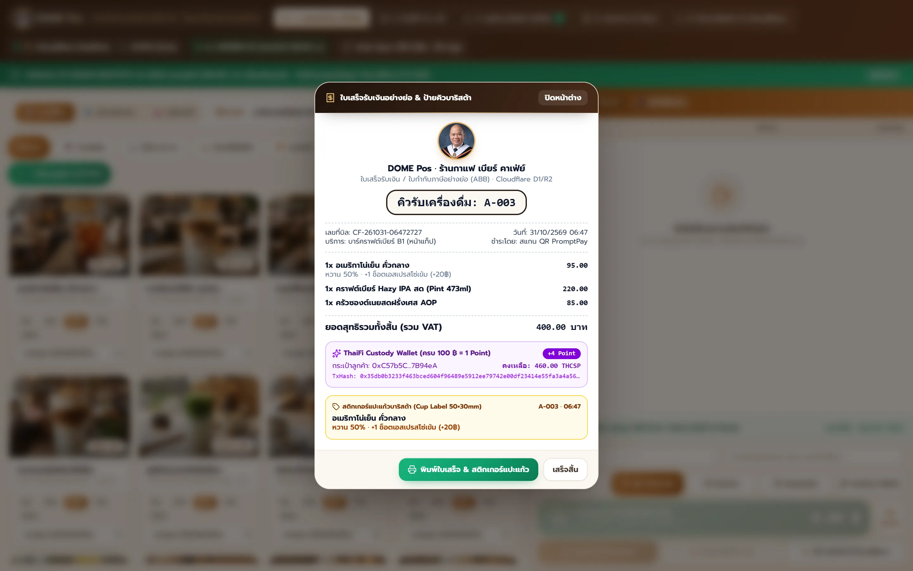
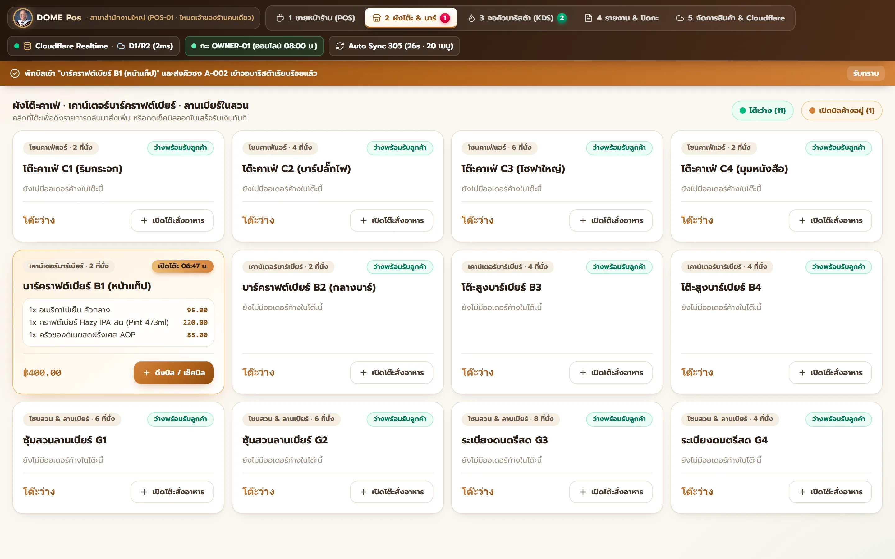
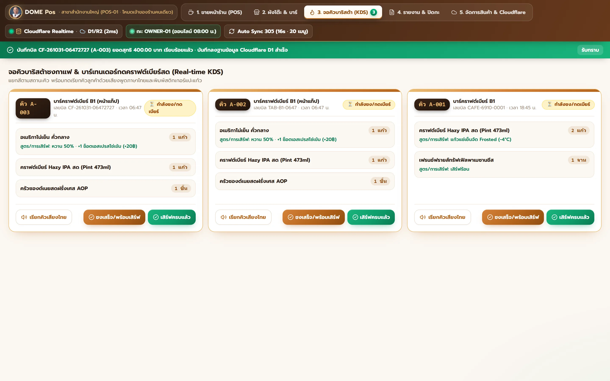
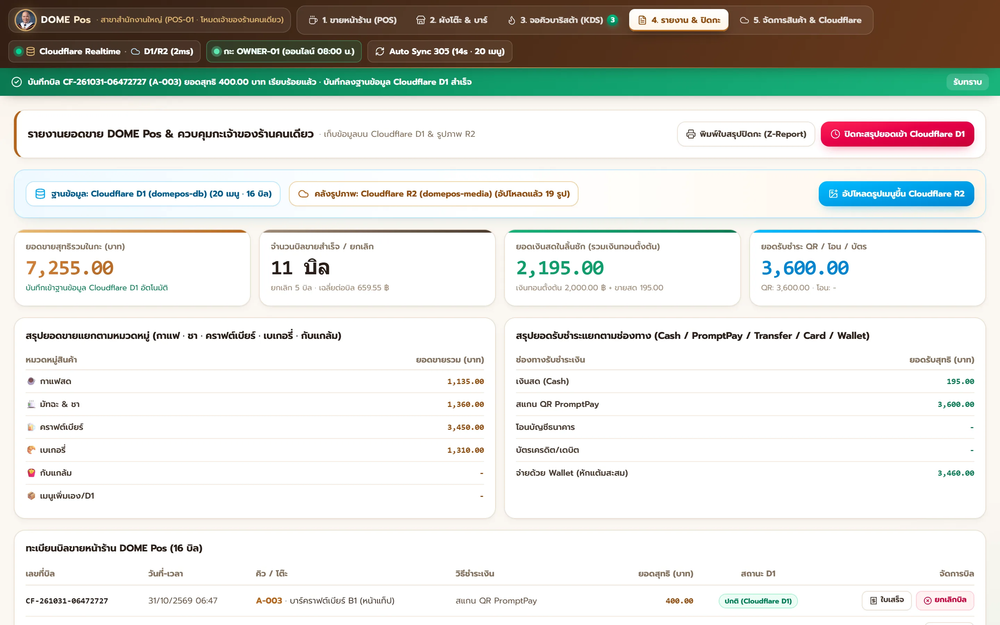
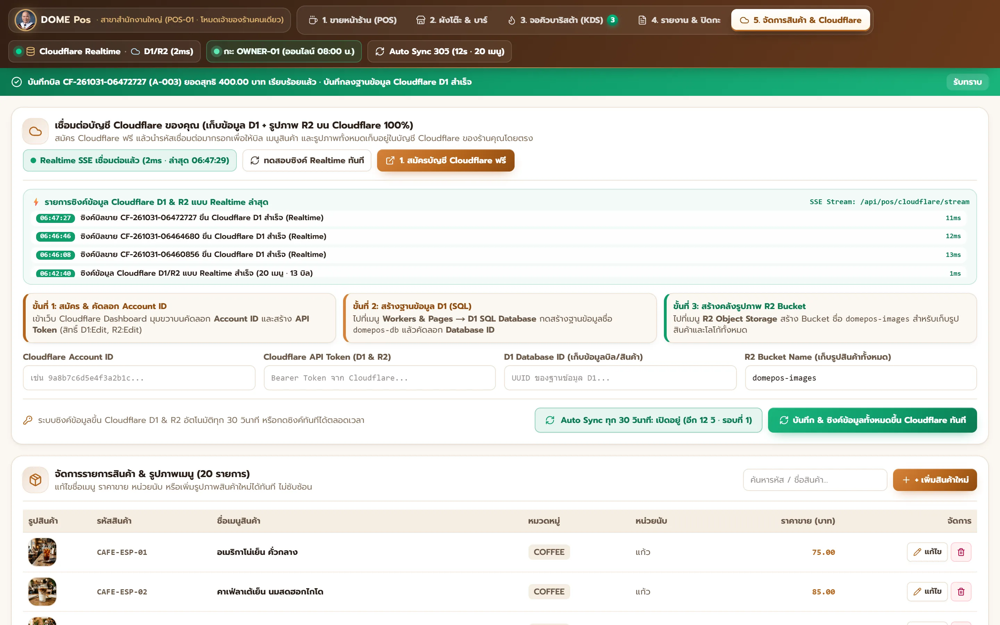
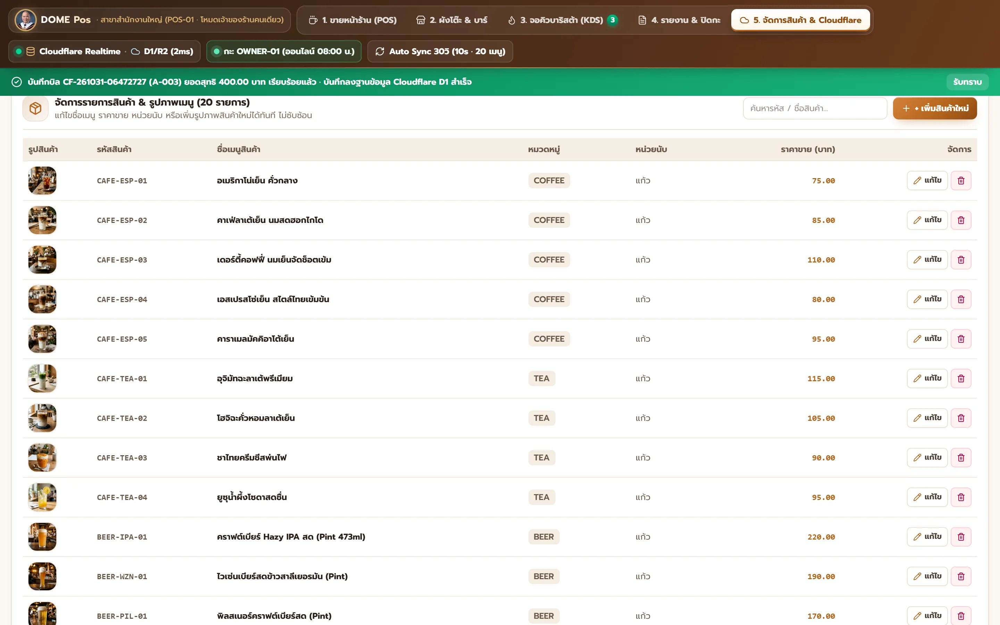

# DOME Pos — ระบบขายหน้าร้านกาแฟ · เบียร์ · คาเฟ่ (สำหรับเจ้าของร้านคนเดียว)

ระบบขายหน้าร้าน (POS) ขนาดกะทัดรัด เปิดหน้าเว็บแล้วขายได้ทันที ไม่มีหน้าล็อกอินกั้น ใช้งานจริงที่ **https://domepos.mysmebox.com**



## Objective (วัตถุประสงค์)
ให้ **เจ้าของร้านที่ทำงานคนเดียว (Solo Owner)** ของร้านกาแฟ คาเฟ่ เบเกอรี่ และบาร์คราฟต์เบียร์ รับออเดอร์ คิดเงิน พักบิลตามโต๊ะ ดูคิวชง สรุปยอดปิดกะ และจัดการเมนูได้ครบในหน้าจอเดียว
- **คิดเงินแม่นยำ:** คิดเงินด้วยเลขทศนิยมแบบ fixed-point ทุกจุด ได้แก่ BigInt ฝั่งหน้าเว็บ (`frontend/src/lib/numeric.ts`) และ `*big.Rat` ฝั่ง backend (`backend/internal/money/rat.go`) ไม่ใช้ float กับเงิน
- **ลงบัญชีครบ:** ทุกบิลลงบัญชี GL แบบ Debit = Credit
- **แยกอิสระ:** แยกจากระบบ SML/smlaiaccount 100% และใช้ฐานข้อมูลของตัวเองชื่อ `domepos` เท่านั้น

## Workflow (ขั้นตอนการทำงาน)
หน้าจอหลัก `frontend/src/components/DomePosScreen.tsx` มี 5 แท็บ:

1. **ขายหน้าร้าน (POS)**
   - เลือกช่องทาง (ทานที่ร้าน / สั่งกลับบ้าน / เดลิเวอรี่) และเลือกโต๊ะ
   - กดการ์ดสินค้าเพื่อเพิ่มลงตะกร้า ปรับความหวานและท็อปปิ้งได้ที่การ์ดหรือในแถวตะกร้า
   - ชำระด้วยเงินสด / PromptPay QR / โอน / บัตร / Wallet หรือกด **ขายด่วนเงินสดพอดี** ได้ใน 1 คลิก
   - ทุกบิลสะสมแต้ม Wallet อัตโนมัติ ครบ 100 บาท = 1 Point (ปัดลง)

   

   
2. **ผังโต๊ะ & บาร์**
   - มี 12 โต๊ะ: โซนคาเฟ่ `C1–C4`, เคาน์เตอร์บาร์ `B1–B4`, โซนสวน `G1–G4`
   - พักบิลลงโต๊ะได้ แล้วดึงกลับมาสั่งเพิ่มหรือเช็กบิลได้ในคลิกเดียว

   
3. **จอคิวบาริสต้า (KDS)**
   - แสดงคิวตามสถานะ `กำลังชง → พร้อมเสิร์ฟ → เสิร์ฟแล้ว`
   - มีปุ่มเรียกคิวด้วยเสียงพูดภาษาไทย

   
4. **รายงาน & ปิดกะ**
   - ยอดขายแยกตามหมวดสินค้าและช่องทางชำระเงิน
   - เปิด/ปิดกะลิ้นชักเงินสด พิมพ์ Z-Report
   - เปิดใบเสร็จย่อ 80mm และสติกเกอร์แปะแก้วซ้ำได้ ยกเลิกบิลได้

   
5. **จัดการสินค้า & Cloudflare** (`DomePosManagePanel.tsx`)
   - เพิ่ม/แก้/ลบเมนู ราคา หมวด หน่วย และรูปสินค้า
   - กรอกบัญชี Cloudflare ของร้าน (D1 + R2) เพื่อซิงค์ข้อมูลแบบ Realtime SSE และ Auto Sync ทุก 30 วินาที

   

   

**หน้าตาและแอนิเมชัน**
- ใช้ design system กลางใน `frontend/src/app/globals.css` (คลาส `dp-*` และตัวแปร `--dp-*`) โทน Espresso + Terracotta พื้นครีม
- มีแอนิเมชันการ์ดทยอยเข้า, ตัวเลขเด้งเมื่อค่าเปลี่ยน, ปุ่มชำระเงินมีแสงวิ่ง และ modal เด้งเข้าพร้อมพื้นหลังเบลอ
- เคารพการตั้งค่า `prefers-reduced-motion` ของผู้ใช้

**สถาปัตยกรรม**
```
Browser ──► Next.js (frontend :3005)
              └─ /api/pos/*  (proxy JSON / รูป / SSE) ──► Go API (backend :8085) ──► PostgreSQL `domepos`
                                                                               └─► Cloudflare D1 + R2 (เมื่อตั้งค่าบัญชีแล้ว)
```
Backend สร้างฐานข้อมูล `domepos`, ตารางมาตรฐาน และเมนูเริ่มต้น 19 รายการให้อัตโนมัติเมื่อรันครั้งแรก

## Config (การตั้งค่า)
ทุกโมดูลมี `.env.example` (ค่าปลอม) ให้คัดลอกเป็น `.env.local` แล้วใส่ค่าจริง **`.env.local` ถูก `.gitignore` ไว้ ห้าม commit ความลับทุกชนิด**

| โมดูล | พอร์ต | ไฟล์ | ตัวแปรสำคัญ |
|---|---|---|---|
| Backend (`backend/`) | `8085` | `backend/.env.local` | `HTTP_PORT`, `PG_HOST`, `PG_PORT`, `PG_USER`, `PG_PASSWORD`, `PG_DATABASE=domepos`, `CLOUDFLARE_*`, `R2_*` |
| Frontend (`frontend/`) | `3005` | `frontend/.env.local` | `SERVICE_BASE_URL=http://127.0.0.1:8085`, `NEXT_PUBLIC_SITE_URL`, `THAIFI_CUSTODY_URL`, `THAIFI_CUSTODY_API_KEY` |
| UAT (`uat/`) | `3056` | `uat/.env.local` | `ERP_TARGET_URL`, `UAT_PG_*`, `UAT_PG_ALLOW_DB=domepos,uat_domepos` |

- **ป้องกันใช้ฐานผิด:** backend จะไม่เชื่อมต่อฐาน `smldemo` เด็ดขาด (`backend/internal/pos/store.go`) ถ้า `PG_DATABASE` ว่างหรือเป็น `smldemo` จะบังคับใช้ `domepos`
- **ค่า Cloudflare:** ถ้ายังไม่ได้ใส่ค่า Cloudflare ระบบทำงานบน PostgreSQL อย่างเดียว และ `/api/pos/bootstrap` จะแสดง `d1_configured: false`

## Dependency (สิ่งที่ต้องติดตั้ง)
- **Go** `1.26+` (ตาม `backend/go.mod`)
- **Node.js** `20.9+`
  - frontend ใช้ npm (`package-lock.json`)
  - uat ใช้ pnpm (`pnpm-lock.yaml`)
- **PostgreSQL** `15+`
- Frontend ใช้ Next.js 16, React 19, Tailwind CSS 4 และ lucide-react

## Usage Example (ตัวอย่างการใช้งาน)

### รันบนเครื่อง (Windows PowerShell)
```powershell
# ครั้งแรก: คัดลอกไฟล์ตั้งค่า แล้วแก้ค่าใน .env.local
copy backend\.env.example backend\.env.local
copy frontend\.env.example frontend\.env.local
cd frontend; npm ci; cd ..

# รันทั้งระบบ (backend + frontend + uat)
.\start-domepos.ps1

# หรือรันแยก
cd backend;  go run ./cmd/api      # http://127.0.0.1:8085
cd frontend; npm run dev           # http://localhost:3005
```

### ตรวจคุณภาพก่อนส่งงาน
```powershell
cd backend;  go test ./...
cd frontend; npx tsc --noEmit
cd uat
node runner/run.mjs --script uat-scripts/pos-e2e-api-db-gl-report.json           --out runs/verify-api  --base http://localhost:3005
node runner/run.mjs --script uat-scripts/pos-data-reconcile-and-promo-audit.json --out runs/verify-data --base http://localhost:3005
node runner/run.mjs --script uat-scripts/pos-starter-cafe-beer-ui-e2e.json       --out runs/verify-ui   --base http://localhost:3005
```
ต้องผ่านครบทั้ง 3 ชุด (17 + 8 + 34 ขั้นตอน, `failed: 0`)

ถ่ายภาพหน้าจอใน README ใหม่ (ต้องรัน backend + frontend บนเครื่องก่อน; สคริปต์นี้สร้างบิลจริงลงฐาน จึงห้ามชี้ไป production):
```powershell
node docs/capture-screenshots.mjs http://localhost:3005
```

### เรียก API ตรง
```bash
curl https://domepos.mysmebox.com/api/pos/health
curl https://domepos.mysmebox.com/api/pos/bootstrap
curl -N "https://domepos.mysmebox.com/api/pos/cloudflare/stream?mode=sse"
```
Endpoint ของ backend ทั้งหมดอยู่ใต้ `/api/v1/pos/`:
`bootstrap`, `sync`, `restore`, `bills`, `shift`, `config`, `devices`, `image`, `media`, `cloudflare/setup`, `cloudflare/stream`, `health`

### Deploy (production)
1. Build backend เป็น Linux binary:
   ```bash
   GOOS=linux GOARCH=amd64 CGO_ENABLED=0 go build ./cmd/api
   ```
2. Build frontend บนเซิร์ฟเวอร์ (`output: "standalone"`):
   ```bash
   npm ci && npm run build
   ```
   จากนั้น copy `public` และ `.next/static` เข้า `.next/standalone`
3. รันผ่าน systemd: `domepos-api` (:8085) และ `domepos-web` (`node server.js` ที่ 127.0.0.1:3005)
4. ใช้ Caddy reverse proxy ไปที่ :3005 โดยไม่บีบอัด path SSE `/api/pos/cloudflare/stream`

## Limitation (ข้อจำกัด)
1. **ไม่มีระบบล็อกอิน (ตั้งใจ)** — ใครเปิด URL ได้ก็ขาย ยกเลิกบิล แก้เมนู และดูรายงานได้ ถ้าเปิดสู่สาธารณะต้องกั้นที่ reverse proxy เอง (เช่น basic auth / IP allowlist)
2. ออกแบบสำหรับ **ร้านเดียว เจ้าของคนเดียว** — ไม่มีระบบหลายสาขา, อนุมัติหลายขั้น, ใบสั่งซื้อ/ใบสั่งขาย หรือภาษีหัก ณ ที่จ่ายแบบ ERP ใหญ่
3. **เสียงพูดเรียกคิวและแจ้งยอด** ใช้ Web Speech API ของเบราว์เซอร์ ต้องมีเสียงภาษาไทย (`th-TH`) ในเครื่อง
4. **การซิงค์ Cloudflare D1/R2** ทำงานเมื่อกรอกบัญชี Cloudflare ของร้านแล้วเท่านั้น
5. **สะสมแต้ม Wallet** ต้องตั้ง `THAIFI_CUSTODY_API_KEY` ถ้าไม่ตั้งหรือเรียกไม่ได้ ระบบใช้ค่าสำรองในเครื่อง
